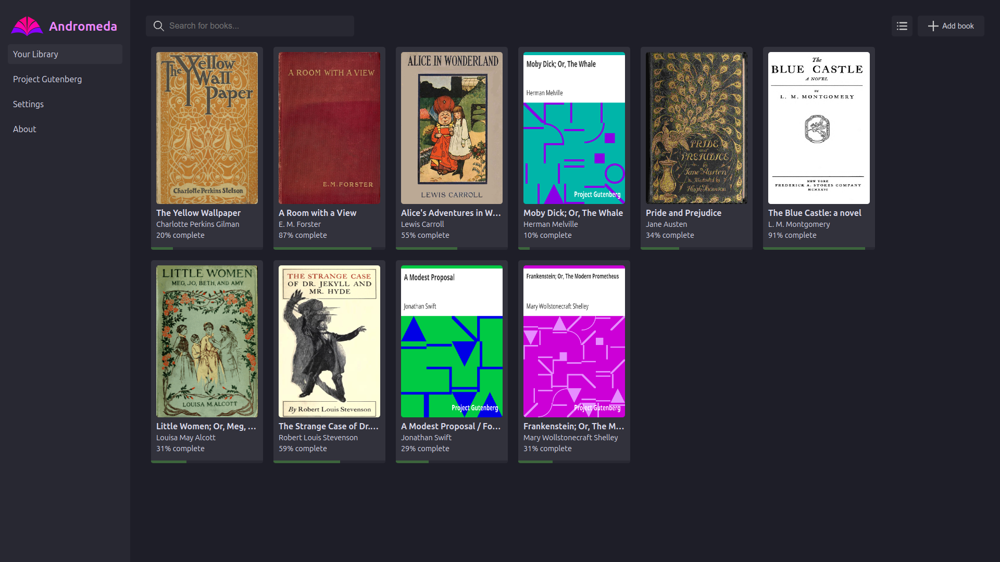
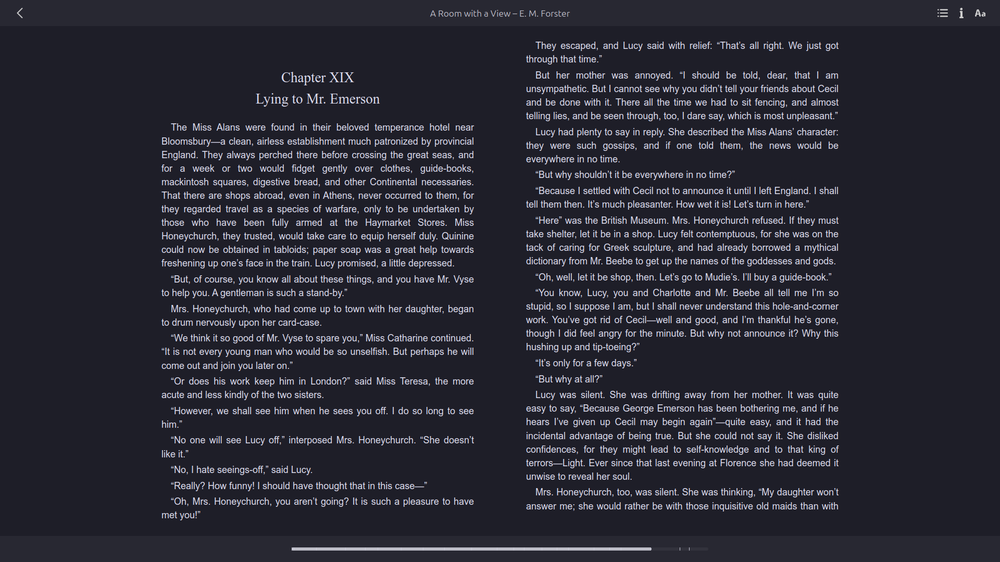
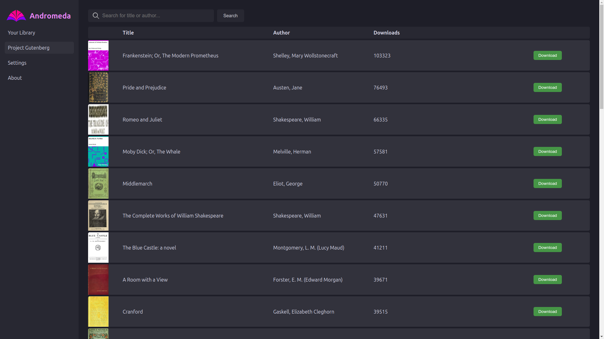
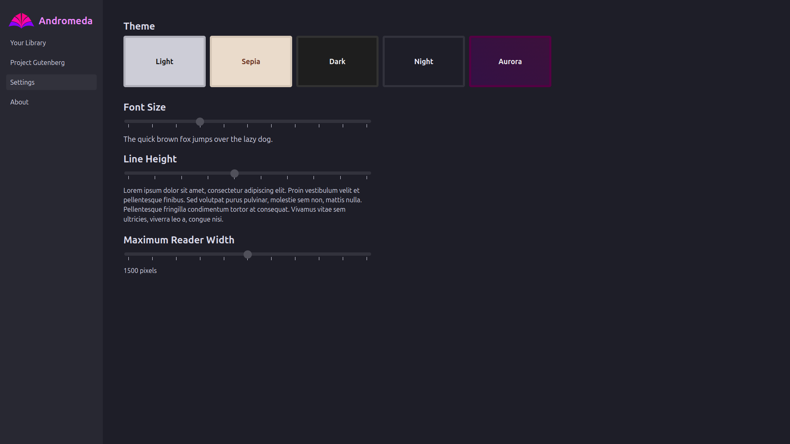

# Andromeda: EPUB Reader for Chrome

Andromeda is an extension for Chrome that allows you to read and manage EPUB files in your browser. Some of its features include:

* A clean, distraction-free reading interface
* Integration with Project Gutenberg's library of free EPUB books
* Five different color themes to choose from
* A built-in library to manage your EPUB files
* Completely free and open-source

## **Architecture**
- **Diagram file:** [assets/architecture.mmd](assets/architecture.mmd)
- **Preview:** The Mermaid markup lives in the linked `.mmd` file; render it with a Mermaid viewer or paste into an online live editor (e.g., mermaid.live) to see the diagram.

The diagram shows the extension UI (`index.html` + `css`), core JavaScript modules (`index.js`, `EpubReader.js`, `Renderer.js`, etc.), background script (`background.js`), and static assets (`images/`, `assets/`).